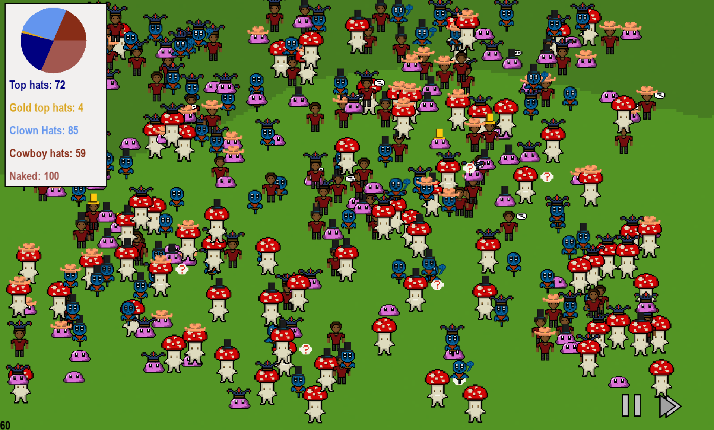
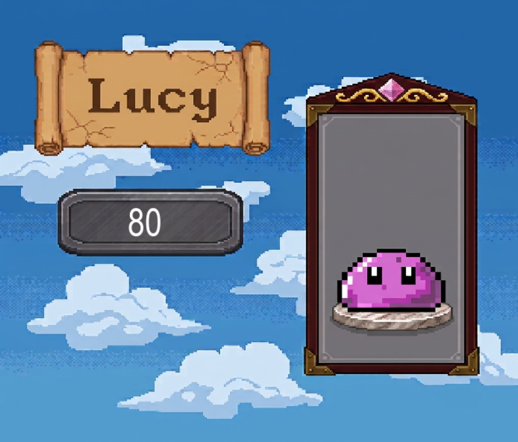
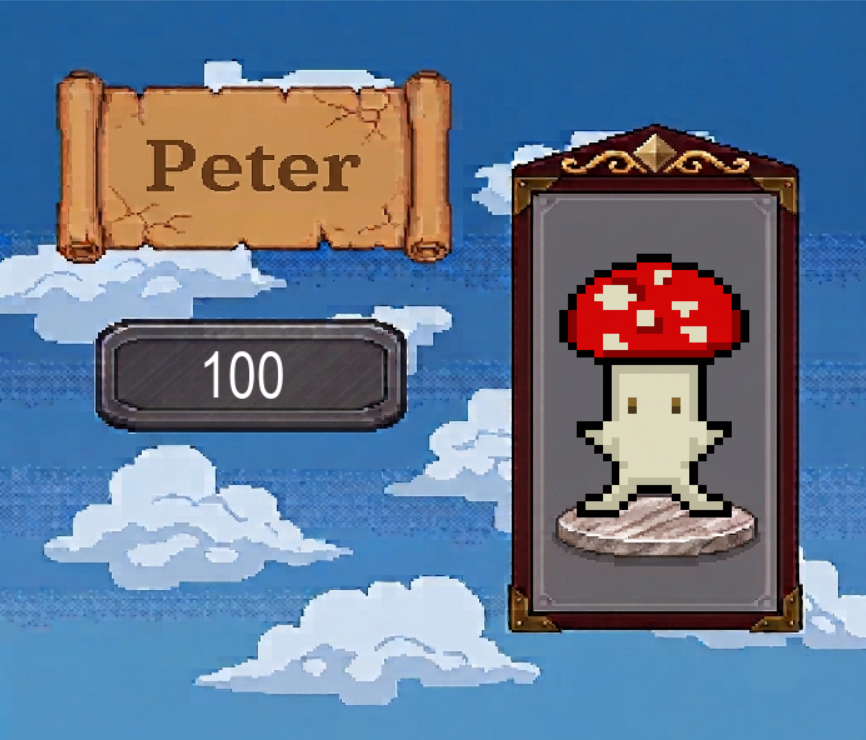
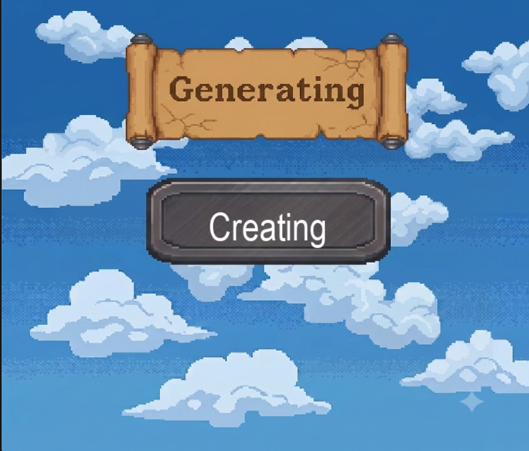
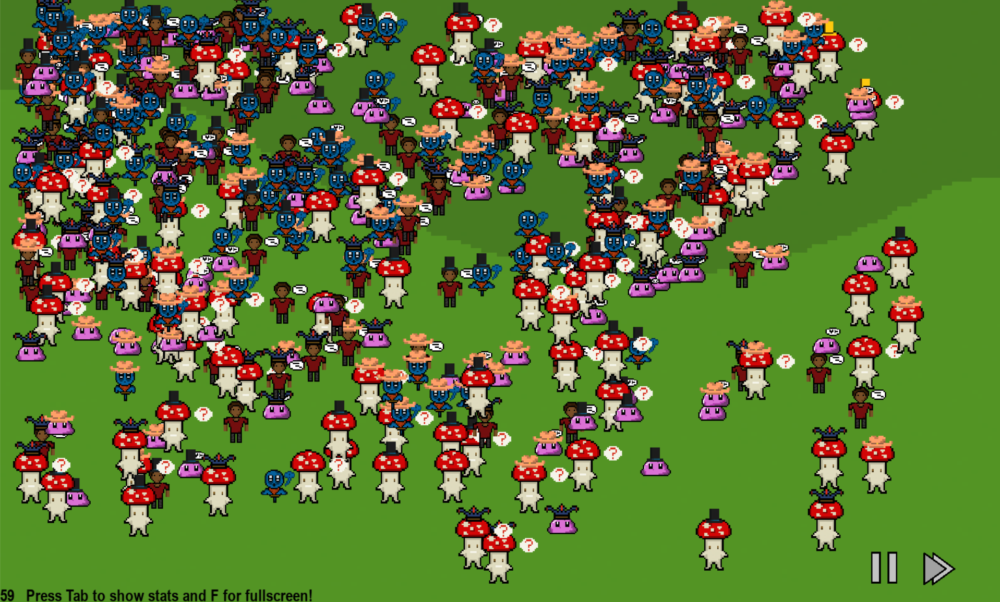

# FishSwarm – Autonomous Multi-Agent Fishing Simulation

FishSwarm is a 2D multi-agent autonomous fishing simulation built in Python with Pygame. Autonomous fishing boats independently explore an ocean using randomized 3×3 grid patterns, discover stationary fish schools, cooperatively recruit the nearest available boats, harvest the biomass, and return to independent exploration upon school depletion.

## Quick Start

### Installation
Ensure Python (>= 3.10) is installed. Install required packages:
```bash
pip install -r requirements.txt
```

### Run Automated Test Suite
All tests run headlessly without opening graphical windows:
```bash
python run_tests.py
```

### Launch Interactive Simulation
Launch the visual Pygame simulation:
```bash
python run_simulation.py
```

### Controls
- **SPACE**: Pause / Resume simulation
- **S**: Cycle simulation speed multiplier (1x → 2x → 4x)
- **D**: Toggle visual debug overlays (detection radii, exploration waypoints, recruitment connection rays)
- **R**: Reset to default scenario
- **ESC**: Exit

---

# What's He Wearing? (Legacy Teammate Project)



A Python/Pygame simulation where generated characters move around, talk and exchange clothing based on confidence values 
to simulate how global trends emerge in a very simple way.

The simulation explores how small, individual interactions can create large-scale changes in a population. Characters 
walk around the world, meet each other and influence one another's clothing choices until eventually one style becomes 
the only option left, once this happens the simulation stops and declares the winner.
---
## Why I chose to create this project

As a Computer Science student that came from a mathematical background, I heavily enjoy statistics. Throughout my
first year learning to code, I felt as though I was missing some key steps to progression; one of them was learning Python.
To challenge myself and broaden my coding skills I had decided to take up a python project. Being familiar with Java
leaned me to an OOP project and with a maths based background I came up with a project I could enjoy and learn from. 

---

## Features
- Optimised collision detection using a spatial grid system
- Autonomous character movement
- Animated sprites and background
- Dynamic clothing assignment
- Character conversations and interactions
- Confidence system
- Clothing inheritance between characters
- Real-time population statistics
- Pause and speed controls
- Complete terrain manipulation concurrent with user window size
- Procedural generation

---

## How It Works

Each character is assigned:

- A random starting position
- A movement direction
- A clothing style
- A confidence value associated with that clothing and their own random self-confidence value

Characters continuously move around the environment. When two characters meet, they can begin a conversation.

During a conversation:
1. The characters compare their confidence values.
2. The character with higher confidence influences the other character.
3. The losing character adopts the winning character's clothing style.
4. The simulation continues until every person shares one homogeneous style.

Clothing styles compete with each other and the population evolves over time.

---
## Technical Details

### Spatial Grid Collision Optimisation

Instead of checking every character against every other character, the simulation divides the world into grid sections,
as this simulation can contain hundreds of objects on screen, a grid is necessary for a smooth experience.
Even at 500 characters (and their various hats), a stable 60fps is observed on a standard mid-range laptop.

Characters only check interactions with others in the same section to utilise the grid.

---

### Object-Oriented Design

Object-oriented programming is used to separate different parts of the simulation.

Example:
- All characters inherit from a superclass
- All clothing inherit from a superclass
- Terrains have their own superclass for easy background switching and creation
---

### Dynamic Animation/Images

Characters alter animation images depending on whether they are talking or walking

Each hats sprite is placed onto their respective characters head correctly, regardless of character state or png size

---

## Controls

| Key / Button | Action |
|---|--------------------------------------------------------------|
| F | Toggle terrain to use entire screen and set screen to fullsize|
| TAB | Overlay clothing piechart|
| Pause button | Pause/unpause simulation|
| Speed button | Increase/reduce simulation speed|

---

## Installation

### Requirements

- Python 3.x
- Pygame

Install dependencies:

```bash
pip install pygame
```

Run the program from the project directory:

```bash
python Whats_he_wearing.py
```

---
## Screenshots of program






---

## Future Improvements

- Add more character personalities
- Add environmental obstacles
- Create more complex social behaviours
- Animate the hat options available
- Separate game state logic into multiple files
- Add sound effects and music

---

## What I Learned/Improved in

- Python object-oriented programming
- Pygame game development
- Sprite animation systems
- Event handling
- Procedural generation
- Simulation design
- Performance optimisation
---

Built using:

- Python
- Pygame